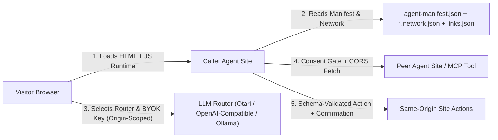

# WWAW — World Wide Agentic Web

[](LICENSE)
[](https://github.com/cognizant-ai-labs/agentic-web/blob/main/docs/worldwide_agentic_web_mvp_spec.md)
[](https://cognizant-agenticweb.devpost.com/)

Open-source implementation and tooling for the **World Wide Agentic Web (WWAW)** — building portable, browser-executed multi-agent websites and interoperable web primitives for the [Open Agentic Web Challenge](https://cognizant-agenticweb.devpost.com/).

## Overview

Personal AI agents today remain largely confined to closed platforms. The [World Wide Agentic Web](https://worldwideagenticweb.org/) initiative establishes an open alternative built on standard web technologies—HTTPS, CORS, ES modules, JSON Schema, and MCP—without requiring new transport protocols, central registries, or proprietary server-side agent runtimes.

This repository provides a clean, spec-compliant foundation engineered against the [Minimum Viable Specification for a Worldwide Agentic Web (MVP Profile 0.2)](https://github.com/cognizant-ai-labs/agentic-web/blob/main/docs/worldwide_agentic_web_mvp_spec.md).

## Architecture & Core Tenets



1. **Common Multi-Agent Representation (Tenet 1):** Agent networks are published as resolved, data-only JSON documents (`*.network.json`) following the [Neuro SAN HOCON](https://github.com/cognizant-ai-lab/neuro-san/blob/main/docs/agent_hocon_reference.md) data model, with JSON Schema invocation contracts and deny-by-default private context (`sly_data`).
2. **Browser Execution & Site Composition (Tenet 2):** The visitor's browser runs the front agent (`front_man`) and orchestrates internal specialists, schema-validated site actions with confirmation gates for writes, bounded execution limits, and consent-first cross-origin peer composition via `agent-manifest.json` and `links.json`.
3. **Pluggable Inference & BYOK (Tenet 3):** Inference is decoupled from the agent graph. Visitors can run networks through a site's default endpoint or supply their own router, model, and API key (such as [Mozilla Otari](https://otari.ai), OpenAI-compatible providers, OpenRouter, or local Ollama). Credentials stay strictly in origin-scoped browser storage and are never placed in manifests, network definitions, traces, or peer-site requests.

## Specification Conformance

| Artifact / Mechanism | Role in WWAW MVP Profile 0.2 | Hosting & Trust Boundary |
| --- | --- | --- |
| `agent-manifest.json` | Public index mapping network names to `front_man`, resolved definition URL, router hints, and peer policy | Public `GET` with CORS enabled for cross-origin callers |
| `*.network.json` | Resolved, data-only agent graph (`metadata`, `tools`) with zero local includes or env substitutions | Public `GET` with CORS; treated as untrusted prompt input when fetched from peers |
| `links.json` | Publisher-owned default bindings mapping symbolic peer references to concrete network URLs | Public `GET`; caller overrides stay browser-local |
| Browser `runtime/` | Pure JavaScript orchestration loop enforcing schema validation, finite budgets, and confirmation dialogs | Same-origin ES modules; optional coded tools isolated in Web Workers with SRI checks |
| BYOK Settings | Visitor-controlled router base URL, model, and credential | Origin-scoped `localStorage` only; never transmitted to peer origins |

For the full compliance breakdown and judging alignment, see [docs/SPEC_COMPLIANCE.md](docs/SPEC_COMPLIANCE.md).

## Repository Structure

```text
.
├── .github/
│   └── workflows/
│       └── ci.yml              # Automated WWAW compliance and secret-hygiene checks
├── docs/
│   └── SPEC_COMPLIANCE.md      # Detailed WWAW MVP 0.2 conformance reference
├── scripts/
│   └── validate_wwaw.mjs       # Zero-dependency validator for manifests, networks, and hygiene
├── CODE_OF_CONDUCT.md          # Contributor Covenant v2.1
├── CONTRIBUTING.md             # Contribution workflow and pre-submission checklist
├── LICENSE                     # Apache License 2.0
├── README.md                   # Project overview and architecture
└── SECURITY.md                 # Threat model, BYOK isolation, and vulnerability reporting
```

## Validation & Security Hygiene

This repository enforces automated checks to maintain spec conformance and prevent accidental credential or local-environment leaks in a public codebase.

Run the validator locally (requires Node.js 20+):

```bash
node scripts/validate_wwaw.mjs
```

The validator checks all tracked files for:
- **Zero-Secret & Clean-Path Hygiene:** Rejects committed `.env` files, API tokens/keys, and local filesystem paths.
- **Manifest Integrity:** Validates JSON syntax and required `name`, `front_man`, and `hocon` fields in any `agent-manifest.json`.
- **Portable Network Data:** Validates `tools` definitions, required agent fields (`name`, `function.description`, `instructions`, `tools`), and verifies that no unresolved HOCON `include` directives or `${...}` substitutions remain in `*.network.json`.
- **Link Map Structure:** Validates `links.json` schema (`version` and `networks` mappings).

## References & Ecosystem

- [World Wide Agentic Web Initiative](https://worldwideagenticweb.org/)
- [Open Agentic Web Challenge (Devpost)](https://cognizant-agenticweb.devpost.com/)
- [Cognizant AI Lab `agentic-web` Reference Repository](https://github.com/cognizant-ai-labs/agentic-web)
- [WWAW Minimum Viable Specification (MVP Profile 0.2)](https://github.com/cognizant-ai-labs/agentic-web/blob/main/docs/worldwide_agentic_web_mvp_spec.md)
- [Neuro SAN Agent HOCON Reference](https://github.com/cognizant-ai-lab/neuro-san/blob/main/docs/agent_hocon_reference.md)
- [Mozilla Otari](https://otari.ai/) & [Project NANDA Index](https://nandaindex.org/)

## License

Licensed under the [Apache License, Version 2.0](LICENSE).
